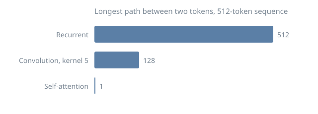
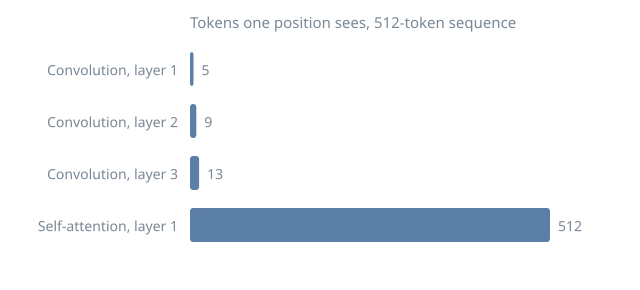

This literature review is the editable Quarto source. To get a PDF or LaTeX source, render it with Quarto (see the [workspace guide](https://github.com/allenai/asta-plugins/blob/main/plugins/asta-tools/skills/workspace/assets/DEVELOPER.md#getting-a-latex-pdf)). This review cites the project-root `references.bib`. The separate `paper/main.tex` is edited directly and paired with Overleaf, so it keeps its own copy of the entries it cites.

## Example claim

[Vaswani and colleagues proposed a Transformer architecture based on attention mechanisms]{.ev key="transformer-attention"} [@vaswani2017attention]. The highlighted claim exposes its source quote on hover or keyboard focus.

## Background

Recurrent networks read a sequence one token at a time, carrying a hidden state from each token to the next.

Gated cells, such as the [LSTM's](https://www.bioinf.jku.at/publications/older/2604.pdf), let that state carry information across longer spans, but a signal between two distant tokens still passes through every step between them.

Encoder–decoder models used one recurrent network to read a sentence and a second to write its translation, joined only by the final state of the first.

That final state had to hold the whole sentence, so translations of long sentences lost detail from their beginnings.

Attention was first added to these models to let the decoder look back at every encoder state, rather than at the last one alone.

Convolutional sequence models shortened the path differently, stacking layers so that each widens the span a token can see.

## Models compared

| Model | Year | Recurrence | Steps between distant tokens |
|---|---|---|---|
| LSTM encoder–decoder | 2014 | yes | one per token between them |
| RNN with attention | 2015 | yes | one, through attention |
| Transformer | 2017 | no | one |

## Encoder–decoder with attention

```{mermaid}
flowchart LR
  src[Source sentence] --> enc[Recurrent encoder]
  enc --> dec[Recurrent decoder]
  enc -. every state .-> att[Attention]
  att --> dec
  dec --> tgt[Translation]
```

## Attention in one line

Each token's output is a weighted average of every token's value:

$$
\operatorname{Attention}(Q,K,V) = \operatorname{softmax}\left(QK^T\right)V
$$

::: {.callout-tip}
## Reading the equation
Q, K and V are the queries, keys and values, one row per token.
:::

```python
scores = q @ k.T
weights = softmax(scores, axis=-1)
out = weights @ v
```

## How far a signal travels

```{dot}
digraph path {
  rankdir=LR;
  node [shape=circle];
  t1 -> t2 [label="step"];
  t2 -> t3 [label="step"];
  t3 -> t4 [label="step"];
  t1 -> t4 [label="attention"];
}
```

{width=80%}

{width=80%}

## Takeaways

- Recurrence reads one token at a time, so the tokens of a sequence can't be processed in parallel during training.
- Gating eases, but doesn't remove, the long path between distant tokens.
- A fixed-size final state limits how much of a long input sentence a decoder can draw on.
- Convolutions shorten the path, but only by stacking more layers as the span grows.
- Attention connects every pair of tokens in one step.
- The Transformer drops recurrence entirely.
