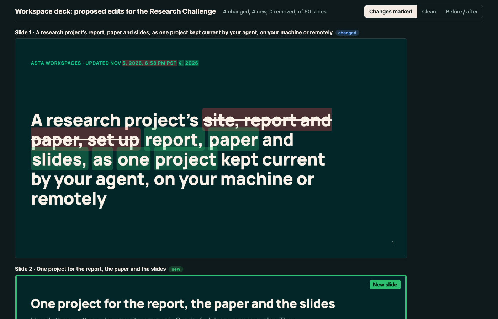
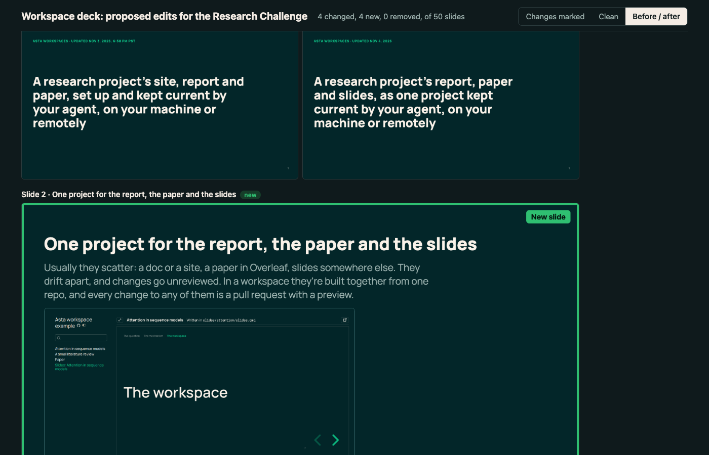

# Prototype: a deck's What changed as rendered slides

A slide deck's changes, shown as the audience will see them, so that a reviewer
can tell where each slide begins and ends and what changed on it. Today's What
changed lists each slide's text in one column, its title, label line and body
run together, with images shown only as their alt text.

This is a working prototype, not wired into the workspace rules. It is here so
that the real implementation starts from behaviour already tried on a 50-slide
deck, not from a description.

## What it does

`deck_review.py OLD_SITE NEW_SITE DECK_PATH OUT_DIR [--title T]` reads two built
sites (say, a PR's base and its head) and writes `OUT_DIR/index.html`:

- each new or changed slide, rendered as the deck renders it, as an image;
- one switch for every slide: **Changes marked** (added words highlighted,
  removed words struck through, on the rendered slide; a new slide outlined
  with a "New slide" badge), **Clean** (the slide as it now is), and
  **Before / after** (the old and new slide side by side);
- removed slides, from the old deck, marked "Removed";
- two unchanged slides around each change, folded into a row such as
  "⋯ 2 unchanged slides (4–5)" that opens to show them, like a code diff's
  context;
- each slide links to that slide in the new deck.

Slides are matched by id (Quarto's slug of the title), then by title; a new
slide whose text mostly matches a removed one is treated as that slide,
retitled.

## What it lacks

- **The browser.** It screenshots slides through `agent-browser`, which a
  workspace or CI doesn't have. The real version needs a headless browser the
  workspace rules already depend on, such as the one CI's theme check uses.
- **Wiring.** It isn't called by `what-changed.py`, `make what-changed` or the
  PR preview; a deck's section of What changed should become this view.
- **Change detection by image.** A slide whose text is unchanged but whose
  look changed (an image swapped, a layout fix) is treated as unchanged.
- **Tests**, and a check that it works on the example workspace's deck.
